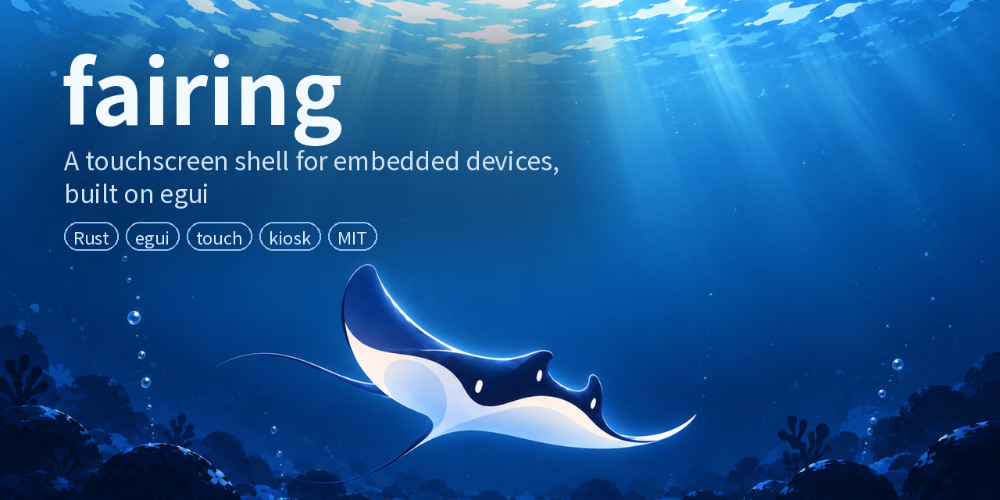
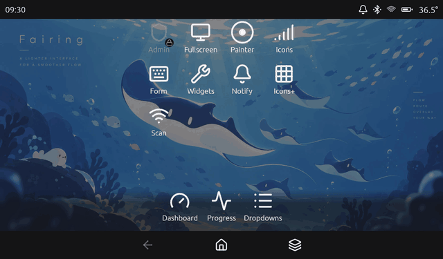
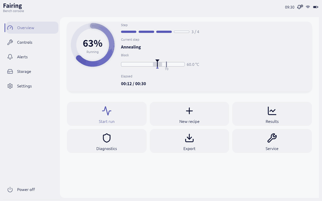
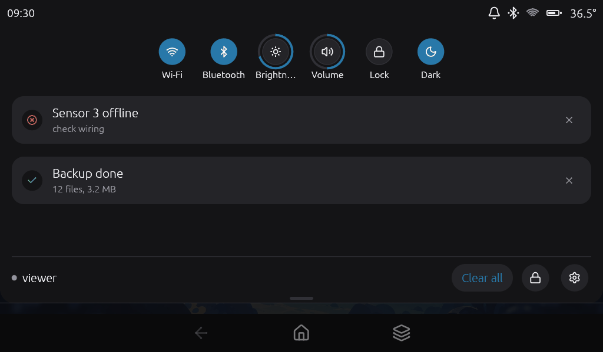
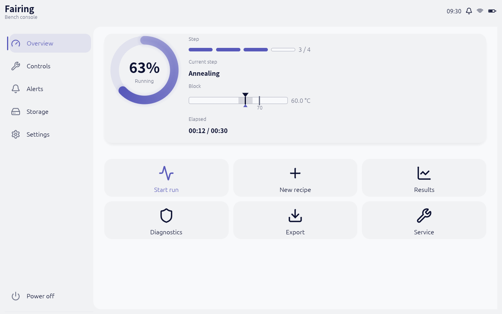
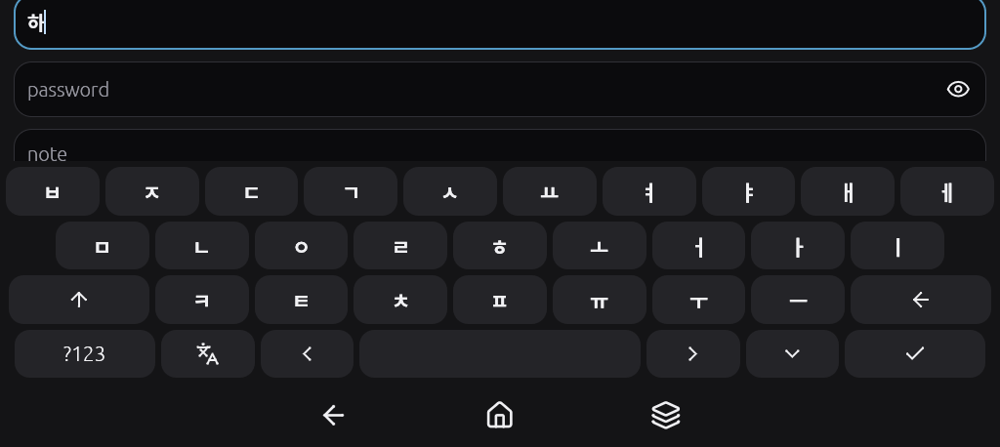
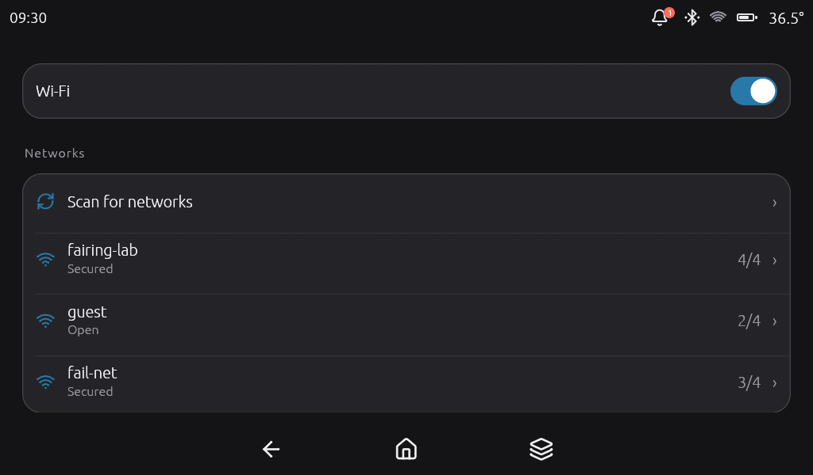

<p align="center">
  
</p>

<p align="center">
  <a href="https://github.com/shim9610/fairing/actions/workflows/ci.yml"></a>
  <a href="LICENSE"></a>
  
  <a href="https://github.com/emilk/egui"></a>
  
</p>

# fairing

A touchscreen shell for embedded devices, built on [egui](https://github.com/emilk/egui).

Fairing provides the UI around your device application: status and navigation bars,
a desktop, screen stacks, quick settings, notifications, an on-screen keyboard and
device settings. Your application owns business state, credential verification and
device backends. Fairing invokes registered screens and backend adapters through
its runners or your egui host. Touch sizes resolve from physical panel dimensions;
screens, chrome and widgets share theme and motion tokens.

**Development toward 0.1.0; the crates are not published yet.** This documentation
describes the current checkout. Start with the [integrator guide](docs/guide/README.md),
or read the [migration guide](docs/guide/10-migration.md) when updating an existing app.

<table>
  <tr>
    <td width="50%"></td>
    <td width="50%"></td>
  </tr>
  <tr>
    <td>An icon zooms open, a screen pushes over it and pops off, home closes it (<code>demo</code>)</td>
    <td>A split shade: each half pulled open as a card on frosted glass (<code>console</code>)</td>
  </tr>
  <tr>
    <td></td>
    <td></td>
  </tr>
  <tr>
    <td>The same shade as a curtain: tiles, notifications, a footer (<code>demo</code>)</td>
    <td>A bench console built from <code>layout</code> and <code>widgets</code> calls only (<code>console</code>)</td>
  </tr>
  <tr>
    <td></td>
    <td></td>
  </tr>
  <tr>
    <td>Two-set Hangul with composition on the on-screen keyboard (<code>demo</code>)</td>
    <td>One of the built-in settings screens (<code>demo</code>)</td>
  </tr>
</table>

## What is included

| Area | Capabilities |
|---|---|
| Shell | Desktop grid and dock, screen stacks, lifecycle events, transitions, two panes and recent-screen cards |
| Chrome | Status/nav bars, pull-down quick settings and notifications, toasts and heads-up banners |
| Input | Touch gestures, edge handles, custom gesture regions, numeric/QWERTY/two-set Hangul keyboard |
| Device integration | Clock, power, Wi-Fi, Bluetooth, display, audio, network and device-information traits, null backends and optional mocks |
| Access | Legacy level gates, credential prompts and lock screens; opt-in issuer-controlled sessions and typed protected UI |
| Layout and widgets | Screen containers, cards, grids, rails and tabs; 23 touch widgets, physical units, vector icons and theme tokens |
| Host integration | Bounded command admission, application-owned command/update transports, caught-unwind quarantine and host-controlled shell replacement |

[`fairing-widgets`](crates/fairing-widgets/README.md) can be used on its own in an
egui application. Fairing re-exports it and egui, so a shell application needs
only the `fairing` dependency.

## Quick start

For a Linux desktop, enable `runner-x11`; a Wayland device can use `runner`.
Pin a reviewed Git revision when integrating a device build.

```toml
[dependencies]
fairing = { git = "https://github.com/shim9610/fairing", features = ["runner-x11"] }
```

This minimal app uses the ordinary `Shell` API. Its default configuration does
not require a login; typed session enforcement is a separate choice below.

```rust,no_run
use fairing::{egui, icon, screen, Cx, Services, Shell, ShellConfig};

#[derive(Default)]
struct AppState { completed: usize }

fn main() -> fairing::Result<()> {
    fairing::runner::run_app(fairing::runner::Options::default(), |ctx| {
        let mut shell = Shell::builder(ShellConfig::default())
            .services(Services::builder().build())
            .physical_mm(154.0, 86.0)
            .build(ctx)?;
        fairing::settings::add_all(&mut shell, &fairing::settings::SettingsConfig::default());
        shell.add(
            screen("dashboard", |ui: &mut egui::Ui, cx: &mut Cx| {
                ui.heading("Dashboard");
                if let Some(state) = cx.app_mut::<AppState>() {
                    if ui.button("Complete operation").clicked() {
                        state.completed += 1;
                    }
                    ui.label(format!("Completed: {}", state.completed));
                }
                if ui.button("Settings").clicked() {
                    cx.open("settings.home");
                }
            })
            .title("Dashboard")
            .icon(icon::GAUGE)
            .desktop(),
        );
        Ok((shell, AppState::default()))
    })
}
```

The [standalone `hello` example](crates/fairing/examples/hello.rs) also shows custom
status/nav items. Run it with:

```sh
cargo run -p fairing --example hello --features runner-x11
```

`runner::run_app` takes a factory returning `(shell, app_state)` and lends that
state to admitted callbacks through `Cx::app::<T>()` / `Cx::app_mut::<T>()`.
Use `run_shell` when no application state is needed; `run_app_with` and
`run_shell_with` deliver `ShellEvent`s to the host.

Set `physical_mm` to the panel's visible dimensions for calibrated touch targets.
Load your product fonts with `ShellBuilder::fonts` or `font`; egui's fallback faces
do not contain Hangul. Without the runner, connect `logic`/`logic_with` and
`frame`/`frame_with` in your own host, then drain `poll_events` after either update.
[Getting started](docs/guide/01-getting-started.md) covers fonts, configuration,
features and hosting.

## Sessions and protected UI

Choose the integration boundary explicitly:

| API | Application registration | Authority |
|---|---|---|
| `ShellBuilder::build` | Ordinary declarations and trusted custom hooks | Legacy level gates by default; token mode can be enabled separately |
| `ShellBuilder::build_protected` | Typed `Protected` declarations, `add_screen` and `add_elements`; no mutable legacy-shell conversion | Requires token mode and checks current issuer grants before protected callbacks |

Your authenticator verifies credentials and owns a non-cloneable
`SessionController`. Fairing holds its read-only `SessionToken`. The issuer expands
roles into independent grants, updates them or terminally revokes the session.
`SessionGrant::base_for(value)` grants authority without a per-grant deadline;
`temporary_for(value, until)` grants additional time-limited authority. Include
`inactive_for(value)` at issuance for a permission that may be enabled later.
The session's gate catalog is fixed: `replace_grants` rejects unknown gates and
removes rights omitted from the replacement. `revoke()` or dropping the controller
ends the session permanently and wakes the shell; a new login issues a new pair.
`SessionGrant` fields are private; use constructors and its `gate()`, `is_base()`
and `temporary_until()` readers.

Use separate controller/token pairs for device and web login state.
`PinTable` is a plaintext reference authenticator for the legacy flow; use your
own `Authenticator` for production credential verification.

Define your own permission enum and map its values to token grant identifiers:

```rust
use fairing::{action, egui, screen, Gate, ProtectedShell, Shell, ShellConfig};
use fairing::access::{Permission, Protected};

#[derive(Clone, Copy)]
enum PermissionId { ViewResults, ExportResults }

impl Permission for PermissionId {
    fn gate(self) -> Gate {
        Gate::borrowed(match self {
            Self::ViewResults => "results.view",
            Self::ExportResults => "results.export",
        })
    }
}

fn build(
    ctx: &egui::Context,
    authenticator: impl fairing::access::Authenticator + 'static,
) -> fairing::Result<ProtectedShell> {
    let config = ShellConfig::default().configure(|c| c.access.session_tokens = true);
    let mut shell = Shell::builder(config)
        .authenticator(authenticator)
        .build_protected(ctx)?;
    shell.add(Protected::new(
        PermissionId::ViewResults,
        screen("results", |ui, cx| {
            ui.heading("Results");
            if ui.button("Export results").clicked() {
                cx.shell.launch(fairing::LaunchAction::run("export"));
            }
        })
            .icon(fairing::icon::GAUGE)
            .desktop(),
    ));
    shell.add(Protected::new(
        PermissionId::ExportResults,
        action("export", |cx| { cx.shell.toast("Export requested"); }),
    ));
    shell.handle().request_unlock(
        PermissionId::ViewResults.gate(),
        Some(fairing::LaunchAction::open("results")),
    );
    Ok(shell)
}
```

This registers requirements and requests login; it does not issue a session. Until the authenticator
returns a valid `AuthOutcome::Session(token)`, protected work is denied. Issue
matching grants with `SessionGrant::base_for(value)` after authentication; the
[session guide](docs/session-tokens.md) covers issuance, asynchronous request
correlation, role expansion, expiry and logout.

For permission-dependent content inside a screen, implement `PermissionBound` and
`elements::Element`, then register an `ElementTree` with `add_elements`. Fairing
omits denied children before measurement/layout and rechecks authority before
paint. Custom `Screen + PermissionBound` implementations use `add_screen`.
A protected screen requirement guards that screen callback; it does not assign
separate permissions to arbitrary `ui.button` calls inside it. Register a protected
`action` for an independently authorized operation, or use permission-bound elements
for separately controlled layout and rendering.
The [typed integration example](docs/session-tokens.md#typed-permission-requirements)
shows nested UI and independent operation permissions.

The `runner::run_shell*`/`run_app*` helpers accept both shell modes through a sealed
host interface. `testing::Harness::from_builder` also accepts `build_protected`.
Register built-in settings with `settings::add_all_protected`, supplying your
permission mapping for each screen ID. Viewing a settings screen does not grant
writes: issue the setting-key grants needed by `Cx::set_setting` or queued
`set_setting` commands separately. The [protected example](crates/fairing/examples/protected.rs)
connects an authenticator, typed screen/action registration, application state and
built-in settings. Its public DEMO marker illustrates wiring; production code must
verify credentials in its own authenticator.
Protected construction rejects untyped global painters/layouts, image loaders and
procedural wallpapers; put custom protected UI in typed declarations or elements.

The [common mediation contract](docs/protected-contracts.md) proves the shared
admission kernel and automatically checks compiler-discovered protected entry
routes. An admitted callback retains raw egui, app and backend access; credential
verification, permission classification and arbitrary callback effects remain
integration responsibilities. This is a UI execution boundary within one process.

## Configuration, host operations and backends

Configuration sections in `fairing::config` and runner `Options` are extensible. Construct them with
`Default` / constructors and consuming `configure` closures instead of exhaustive
struct literals. A `ShellConfig` can also be loaded from TOML. Register executable
screens, actions and UI items in code; configuration assigns their presentation
and gate identifiers.

Use task-specific ordinary `Shell` operations for runtime changes:

| Task | Public API |
|---|---|
| Register or replace UI by ID; remove UI | `add` replaces an existing ID; `remove` unregisters it. Protected hosts use typed `add`, `add_screen`, `add_elements` and `remove` |
| Background, dock or desktop page | `set_wallpaper`, `set_dock_placement`, `set_desktop_page` |
| Status and navigation configuration | `set_status_items`, `status_item_spec` / `set_status_item_spec`, `set_nav_style`, `set_nav_height` |
| Metrics | Edit the owned value from `metrics_spec()`, then commit with `set_metrics_spec` |
| Backend replacement | `set_services`, `set_clock`, `set_wifi_backend`, `set_display_backend` and the other backend-specific setters |
| Trusted host hardware command | `request_service(ServiceRequest::...)`; user-driven setting writes use `set_setting` |
| Protected host observations | `observe()` returns `shell::ShellView` for layout, settings values, session state and authorization decisions |

For example, a status-item edit is detached until committed:

```rust
fn widen_clock(shell: &mut fairing::Shell) -> bool {
    let Some(mut spec) = shell.status_item_spec("status.clock") else {
        return false;
    };
    spec.min_width = Some(84.0);
    shell.set_status_item_spec("status.clock", spec)
}
```

The shell owns live component state and invalidates derived layout when a change
is committed. `ProtectedShell` exposes the narrow observation view and protected
operations; it provides neither mutable component loans nor `request_service`.
Admitted callbacks still receive their documented UI, app-state and backend access.
See [host API decisions](docs/host-api-decisions.md) for migration from earlier
component-mutation APIs.

Implement the clock, power, Wi-Fi, Bluetooth, display, audio, network and information
backend traits, or register a custom backend with `Services::builder().custom(...)`.
`Services::builder().build()` supplies `SystemClock` and Null device backends;
`Services::null()` also replaces the clock with a fixed Null clock. Workers and
transport belong to the application. Backends expose snapshots, are polled by the
shell and use their attached `Waker` to request updates. Runtime backend replacement
attaches the new backend before publication; attachment faults quarantine the shell.

Persist `ShellEvent::SettingChanged` values in application storage. Ordinary hosts
can use `Shell::restore_settings` for trusted startup restoration. Interactive
writes use setting dispatch and its permission checks. Fairing performs no settings
persistence itself.

See [customization](docs/guide/04-customization.md),
[services](docs/guide/06-services.md) and the
[configuration reference](docs/guide/07-config-reference.md).

Command admission defaults to 1,024 shared slots and 256 commands per update.
Use `try_send` to recover rejected ownership. Optional display work has separate
bounds and fallible APIs. Caught callback unwinds quarantine the shell; the host
chooses recovery. These mechanisms do not establish whole-renderer recovery from
heap exhaustion; the fixed-heap crate is an isolated unpublished diagnostic.
[Memory and recovery](docs/memory-limits.md) describes the limits and APIs.

Both shell modes support `restart_with`; a protected replacement factory must
return `ProtectedShell`. Old handles are closed before replacement, and a failed
replacement leaves dispatch quarantined. `run_shell_with_recovery` and
`run_app_with_recovery` let the host choose when to attempt replacement. Application
state, external side effects and egui/GPU recovery remain host responsibilities.

## Examples

```sh
cargo run -p fairing --example demo --features runner-x11 -- --size=1024x600
cargo run -p fairing --example console --features runner-x11 -- --size=1280x800
```

| Example | Focus |
|---|---|
| `hello` | A minimal standalone app |
| `protected` | Issuer-owned sessions, typed screen/action permissions, app state and protected settings |
| `demo` | Shell features, settings, keyboard and legacy unlock prompts |
| `console` | Bench instrument, rail layout and split shade |
| `kiosk` | Café ordering, portrait/counter/compact layouts and live language switching |
| `custom_chrome` | Custom bar, desktop cells, wallpaper and tiles |
| `motion_lab` | Interactive motion-token tuning and TOML export |
| `palette_sheet` | Widget palette comparison |
| `bench` | Headless frame-time scenarios |

The gallery comes from the example tours. [Contributing](CONTRIBUTING.md#rebuilding-the-readmes-animations)
explains screenshot and GIF regeneration.

## Verification

`fairing::testing::Harness` drives actual egui frames without a window or GPU and
reports rendered geometry for pointer-driven tests. The repository also checks:

| Check | Evidence |
|---|---|
| Strict audit | Formatting, Clippy, workspace/guide doctests, API docs, dependency approvals, generated files, aarch64 type-check and blocking-call scan |
| API and UI regressions | Native/generated histories, retained widget state, independent expectations and production mutation controls |
| Protected execution | Source-bound Kani/Verus kernel proofs, compiler-derived routing checks and extension/bypass controls |
| Additional assurance | Miri, Loom concurrency scenarios, sanitizer fuzzing, coverage and dependency inventories |
| Release archives | Extracted-package tests and an external consumer for minimal/default/all features |
| Code scanning | GitHub-managed CodeQL for Rust, Python and Actions |

```sh
cargo run -p xtask --locked -- audit --strict
```

[Rust assurance](docs/rust-assurance.md), the [API contract map](docs/api-contracts.md)
and [release checks](docs/release-checks.md) describe commands, evidence and scope.
Verification is tied to source/configuration; it is not a certification of arbitrary
application code or all possible UI histories.

## Platforms and current limits

The target is embedded Linux on x86_64/aarch64 with OpenGL ES 2 through eframe's
`glow` backend. CI runs the full audit and graphical tours on Linux and type-checks
aarch64; it does not validate a physical aarch64 device. Selected CPU display and
runtime-fault checks also run on Windows. The complete Windows runner and macOS
are not validated. The declared minimum Rust version is 1.95; repository development uses 1.99.

Built-in text is English/Korean; supply translations and fonts for your product.
The keyboard has numeric, QWERTY and two-set Hangul layouts. There is no accessibility
tree or right-to-left layout. See the [roadmap](docs/roadmap.md) for further limits.

## Documentation and workspace

| Resource | Purpose |
|---|---|
| [Integrator guide](docs/guide/README.md) | Installation, screens, chrome, access, backends and deployment |
| [Migration](docs/guide/10-migration.md) | Source and behavior changes from the earlier checkout |
| [Architecture](docs/architecture.md) | Component ownership, host update flow and module map with SVG diagrams |
| [Security architecture](docs/security-architecture.md) | Issuer/token ownership, protected admission, session lifecycle and trust boundaries |
| [Session contract](docs/session-tokens.md) | Issuer/session lifecycle and typed UI integration |
| [Protected mediation](docs/protected-contracts.md) | Shared kernel and automatic route verification |
| [Application metadata checker](docs/permission-metadata-check.md) | Check your workspace's permission declarations |

Build the local API reference with `cargo doc -p fairing --all-features --no-deps --open`.
docs.rs will host it after publication. The [changelog](CHANGELOG.md) records changes.

`fairing` and `fairing-widgets` are the product crates. `xtask` owns repository
maintenance; `verification` is an unpublished assurance workspace.
`fairing-fixed-heap` is a diagnostic with no product dependency edge.

## Security and licence

Report vulnerabilities privately through [SECURITY.md](SECURITY.md).
MIT; see [LICENSE](LICENSE) and [third-party notices](THIRD_PARTY.md).
