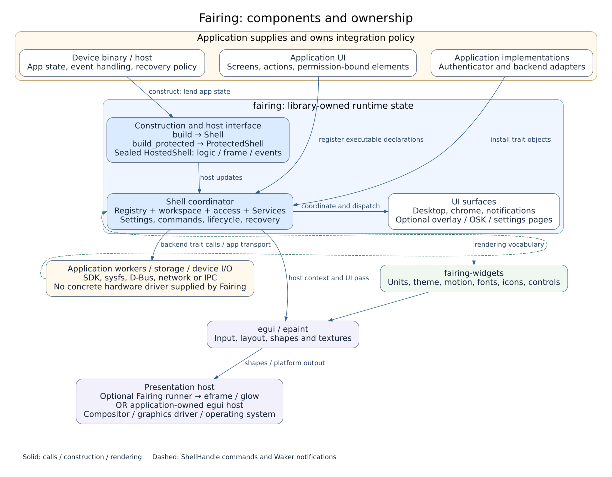
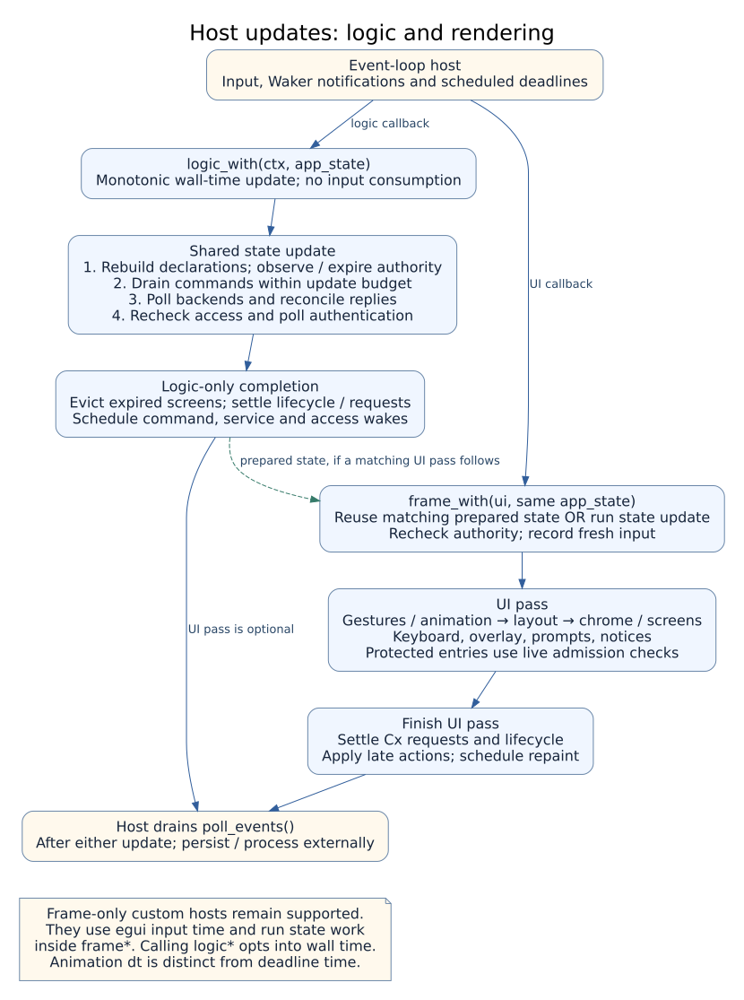

# fairing architecture

This page is the map of the crate: what sits where, how one frame runs, how threads talk to the
shell, and the rules the code keeps. It describes the code in the repository today. How to use
each part is in the [integrator guide](guide/README.md); what is planned is in the
[roadmap](roadmap.md).

## 1. Layers

Fairing is an in-process UI library. The application selects the host, supplies UI
and backend implementations, owns business state and chooses authentication,
persistence and recovery policy. The library owns its live shell state and the
coordination of registered callbacks.

Solid arrows show construction, calls or rendering flow. Dashed arrows show
commands and wake notifications. The boxes describe ownership and integration;
they are not separate operating-system processes. `runner` is an optional host
adapter inside `fairing`, not a required layer below the widgets. An existing egui
application can host either shell mode directly.

### egui and eframe responsibilities

The dependency APIs cited here are version 0.37.0. Fairing uses these mechanisms;
its shell abstractions do not replace them.

| Upstream mechanism | Fairing integration | Upstream reference |
|---|---|---|
| Immediate-mode layout, rectangle allocation and widget interaction | Screen containers, chrome regions, themed controls and shell gesture coordination | [egui `Ui`](https://docs.rs/egui/0.37.0/egui/struct.Ui.html), [`Response`](https://docs.rs/egui/0.37.0/egui/response/struct.Response.html) |
| Pointer/keyboard state and scroll areas | Shell gestures, keyboard routing and themed page helpers | [`InputState`](https://docs.rs/egui/0.37.0/egui/struct.InputState.html), [`ScrollArea`](https://docs.rs/egui/0.37.0/egui/containers/scroll_area/struct.ScrollArea.html) |
| Per-widget focus, clipping and shape submission | Fairing chooses shell pane focus, callback regions and admission; admitted UI uses egui | [`Response::request_focus`](https://docs.rs/egui/0.37.0/egui/response/struct.Response.html#method.request_focus), [`Ui::set_clip_rect`](https://docs.rs/egui/0.37.0/egui/struct.Ui.html#method.set_clip_rect), [`Painter`](https://docs.rs/egui/0.37.0/egui/struct.Painter.html) |
| Point-to-pixel scale and texture allocation | Fairing converts its physical-size parameters and installs product fonts/images | [`Context::set_pixels_per_point`](https://docs.rs/egui/0.37.0/egui/struct.Context.html#method.set_pixels_per_point), [`Context::load_texture`](https://docs.rs/egui/0.37.0/egui/struct.Context.html#method.load_texture) |
| Repaint requests | Fairing requests updates for pending work and animation; the host schedules execution | [`Context::request_repaint`](https://docs.rs/egui/0.37.0/egui/struct.Context.html#method.request_repaint), [`request_repaint_after`](https://docs.rs/egui/0.37.0/egui/struct.Context.html#method.request_repaint_after) |
| Window/event-loop integration and renderer | The optional Fairing runner connects shell logic and UI to eframe; custom hosts provide their own integration | [eframe `App`](https://docs.rs/eframe/0.37.0/eframe/trait.App.html) |

Physical-size conversion uses the supplied panel dimensions and host scale. It is
not automatic display calibration. Presentation timing, hardware input quality
and device usability require validation in the integrating product.

### State and implementation ownership

| Object | Concrete ownership and access |
|---|---|
| Application state `S` | The host owns it; `run_app*` stores the factory's `(shell, S)`. `logic_with` and `frame_with` lend the same value through `Cx::app` / `app_mut` |
| `Shell` | Owns registry, workspace, access state, backend trait objects, settings view and command receiver |
| `ProtectedShell` | Owns a private `Shell` with mandatory mediation; exposes typed registration and `shell::ShellView`, with no mutable conversion |
| Registered callbacks and elements | Supplied by the application; executable storage and guarded invocation are library-owned |
| `Authenticator` / backend adapters | Supplied by the application and held as trait objects by the shell; credential verification, workers and external I/O remain application integrations |
| Session writer / reader | The issuer owns `SessionController`; the shell holds an optional read-only `SessionToken`. See [security architecture](security-architecture.md) |
| Device and persistent state | Supplied by the application, device or external service; Fairing does not implement a hardware driver, credential store or settings database |

The device boundary is a set of traits for clock, power, Wi-Fi, Bluetooth,
display, audio, network and device information, plus custom backends. A backend
may adapt sysfs, a vendor SDK, D-Bus, network services or application workers.
`Services::builder().build()` supplies `SystemClock` and Null device backends;
`Services::null()` also uses a fixed Null clock. Optional Mock backends simulate
devices for development ([guide 06](guide/06-services.md)).

## 2. The workspace

| Crate | Release role | What it holds |
|---|---|---|
| `fairing` | Planned public crate | The shell, including re-exports of `fairing-widgets` and `egui`; application adapters may need other dependencies |
| `fairing-widgets` | Planned public crate | Units, the theme, motion, icons, fonts and the touch widgets. A control can be worked on here without the shell |
| `fairing-fixed-heap` | Unpublished diagnostic | Isolated allocation-failure diagnostic; no product dependency; one scoped unsafe arena claim |
| `xtask` | Unpublished tool | The audit gate, the icon compiler, the license report and the other maintenance commands |

The first crates.io release has not been published yet. `verification/` is a
separate unpublished Cargo workspace for assurance and is not a product dependency.

`fairing` depends on `fairing-widgets`, `egui`, `serde`, `toml` and `log`, plus `eframe` behind `runner` and `chrono`
behind `chrono`. Cargo dependency approvals are checked through `deps.allow` and
`deny.toml`. Asset licences and attribution are reviewed separately and recorded in
the hand-maintained asset section of `THIRD_PARTY.md`; the dependency scanner does
not inventory new image or font files.

egui and eframe use the 0.37 API. The optional runner keeps GL, Wayland, bundled fonts and
OS clipboard support explicit, with X11 added by `runner-x11`. For an overdue redraw,
eframe can call `App::logic` while a Wayland compositor withholds frame callbacks. It
does not run `App::ui` or force a frame to be presented. `run_shell*` and `run_app*` call
`Shell::logic*` there: commands, backend snapshots, access expiry/authentication, stopped
screen eviction and lifecycle requests continue on the event-loop thread. Their `ui`
callback draws without repeating the same state update. The closure-only `runner::run`
has no shell to tick; a custom host must connect `Shell::logic*` itself.

### Features

| Feature | Default | What it adds |
|---|---|---|
| `overlay` | on | The shade: quick-settings tiles, the notification list, the scrim |
| `osk` | on | The on-screen keyboard |
| `settings` | on | The built-in settings screens; the settings value model remains available without this feature |
| `brand` | on | The manta mark and the Abyss background |
| `mock` | on | Mock backends for development |
| `runner` | off | An eframe window bootstrap, `runner::run_shell` |
| `runner-x11` | off | The same, with X11 as well as Wayland |
| `chrono` | off | A clock that follows the system time zone and daylight saving |

Feature flags remove the corresponding drawing and integration code. Shared
configuration and value types can remain available when a subsystem is disabled.

## 3. Modules

The public module paths below provide the API entry points. Private implementation
files separate coordination from subsystem work:

- `shell`: authentication/session handling, setting dispatch, navigation, state
  updates and rendering; `mod.rs` retains the shell's state and public facade.
- `workspace`: lifecycle, split/overview coordination, gestures and rendering;
  the inline test suite lives in `workspace/tests.rs`.
- `settings/screens`: device pages, network forms and credential administration,
  with shared retained-form ownership in the parent module.
- `overlay`: transitions and rendering, with panel tiles, notifications and footer
  rendering in separate files.
- `desktop`: page state, grid/dock/icon rendering and the rail.
- `layout`: containers, rows and fitting functions re-exported from `layout`.
- `widgets/dropdown`: trigger painting, popup behavior and shared painting helpers.

These file boundaries do not change the state owner or the frame/deadline order.
Method implementation modules use parent-scoped visibility for cross-file helpers;
they do not expose new application APIs.

| Module | What it does |
|---|---|
| `shell` | `Shell`, `ProtectedShell`, `ShellBuilder`, `ShellHandle` and `ShellEvent`. Runs the frame below |
| `elements` | Permission-aware leaf/row/column trees with library-owned filtering, measurement, layout and paint dispatch |
| `screen` | `Screen`, `ScreenDecl`, `Cx`, `ChromePolicy`, the lifecycle. A screen is a closure or a type you register |
| `workspace` | The screen stack, transitions, two panes with a divider, the recent screens |
| `desktop` | The icon grid, pages, the dock and the icon rail, the wallpaper |
| `chrome` | The status bar and the nav bar, their items, layouts and painters |
| `overlay` | The shade, its detents, tiles and notification list |
| `osk` | The on-screen keyboard: numeric, QWERTY and two-set Hangul |
| `notify` | Notifications, toasts and heads-up banners |
| `inbox` | Non-waiting channel receive APIs, bounded admission and connection-specific storage/work limits |
| `bridge` | Optional application-implemented command/update transport traits; no transport or thread policy |
| `recovery` | Fault guidance, shell-replacement errors and panic-payload cleanup diagnostics |
| `memory` | Re-exported fixed pools, fallible strings, display windows and CPU raster helpers |
| `gesture` | One gesture engine for edges, flings, long presses, handles and your own regions |
| `access` | Legacy levels/gates, issuer-controlled controller/token sessions, typed permission bindings, common admission kernel, credential prompts and `Authenticator` |
| `settings` | Setting keys and values, and the built-in settings screens |
| `services` | The backend traits, `Null` and `Mock`, `Services`, `Waker` |
| `i18n` | The string table, with English and Korean built in, switched live |
| `config` | `ShellConfig`, read from `fairing.toml` and validated |
| `time` | Clocks and wall time |
| `brand` | The mark and the procedural background |
| `testing` | `Harness`: frames with no window and no GPU |
| `runner` | The optional window bootstrap |

### Protected execution

Construction selects either ordinary `Shell` registration or `ProtectedShell`.
Both implement the sealed `HostedShell` operations used by runners and harnesses;
this host interface does not expose registration, mutable components or conversion.
A protected replacement factory must return another `ProtectedShell`.

Protected registration binds application permission values to declarations and
nested elements. The issuer owns session mutation; the library reads live token
authority and mediates registered payload entries. Viewing a settings screen and
writing a setting are separate requirements. Admitted application bodies retain
raw UI/app/backend access.

The [security architecture](security-architecture.md) gives the authority boundary,
registration/admission path, session lifecycle and proof assumptions. Detailed
contracts remain in [sessions](session-tokens.md),
[common mediation](protected-contracts.md) and
[application metadata checking](permission-metadata-check.md).

## 4. One frame

This figure separates host callbacks from the state and rendering stages below.
A logic callback can complete without a UI callback. A matching UI pass reuses its
prepared state, while rechecking authority and recording fresh input; a frame-only
host runs state processing inside the UI call instead.

For a frame-only host, `Shell::frame(ui)` runs this sequence. Shell/state runners run
state stages 1–4 in `Shell::logic*` first, including when no UI follows; the UI pass
records fresh activity and reuses that state update before gestures and drawing.
Eviction and lifecycle requests can also finish during logic-only calls.

| # | Step | What happens |
|---|---|---|
| 1 | Time, declarations and expiry | Advance time, rebuild declarations, observe integrator subject replacements, enforce overdue access deadlines and revalidate open gates before commands or input |
| 2 | Commands | Receive and execute at most `max_commands_per_update` queued commands (default 256); request continuation for remaining work |
| 3 | Services | Poll backends, confirm outstanding Bool commands and send queued targets, gather backend wake-ups |
| 4 | Access | Revalidate policy after backend updates, record input and poll the authenticator |
| 5 | Input | Advance shell gesture, guard, shade, Back, keyboard and animation state |
| 6 | Layout | The rects for this frame from the focused screen's chrome policy and the keyboard |
| 7–9 | Draw | The status bar, the nav bar, then the desktop or the screens |
| 10–13 | Layers | The keyboard, the shade, the unlock prompt or lock screen, then toasts and banners |
| 14 | Outputs | Launches, back, home, actions from the shade and notifications, lifecycle events |
| 15 | Repaint | Request an immediate update for active work or a delayed update for the next scheduled wake |
| 16 | Events | You take them with `poll_events` |

Backend polling does not freeze a frame-wide snapshot. UI reads call backend
getters, which may return an implementation-owned cache or observe newer state.
An application that needs a consistent device-data revision across several reads
must provide that consistency in its backend or application state.

The deadline clock is the shell's monotonic `Instant`, distinct from the calendar
`WallTime` returned by a backend's `ClockSource::now()`. Changing device wall time
does not redefine the session's monotonic deadline timeline.

For each `Shell::frame` pass, shell layout is computed before screen drawing.
Requests made through `Cx` while drawing, such as opening another screen, are
handled later in that pass. `Cx::shell` sends through `ShellHandle` and waits for
a subsequent state update and its command budget.

## 5. Threads

- **The UI is one thread.** `Shell` does not need to be `Send`.
- **UI shared state uses channels and atomics.** The audit bans application-level
  Mutex/RwLock/Condvar and blocking calls in UI sources. Standard channels may
  synchronize internally; the isolated diagnostic allocator uses a spinlock. There is
  no wait-free or hard real-time guarantee.
- **Command admission is bounded.** All handles share 1,024 slots by default and
  an update executes at most 256 commands. Builder options adjust both. Full
  rejection preserves ownership through `try_send`; accepted work is not evicted.
  [Memory limits](memory-limits.md) explains factories, metrics, fixed storage,
  newest-sample display windows and allocation-free CPU preview/warning primitives.
  There is no renderer process/IPC layer. The ordinary egui path is still allocating.
- **UI queue operations do not wait for work or capacity.** They use `try_recv` and
  immediate admission rather than blocking receive/join/sleep calls. Runtime callbacks
  and transports supplied by the application must return promptly; the audit does not
  enforce that on external code. Startup configuration/font loading can read files.
  A worker thread may wait on its own queue.
- **`ShellHandle` is `Clone + Send`.** Any thread can launch a screen, go back or home, post a
  notification or a toast, change a setting or ask for an unlock. Sending wakes the UI.
- **Backends ask to be woken.** A backend holds a `Waker` and calls `wake()` when its state
  changes. Something due later, such as a scan finishing, is `next_wake()`, not a timer thread.
- **Logic-only work uses wall time.** egui retains the last UI input during `run_logic`.
  The shell uses a shared monotonic wall timeline once `Shell::logic*` is used, so stale
  input cannot renew a session and returning to UI cannot count the hidden interval twice.
  A host using only `Shell::frame*` retains egui's input timeline for headless simulation.
  Hidden scheduling follows backend/access/eviction deadlines and bounded queued work;
  animations, held pointers and continuous repaint do not keep it spinning.
- **Screenshot callbacks only deliver data.** A per-request `Inbox` carries the image back to
  the UI thread and the callback asks for a repaint. Closing a card, changing its theme or
  viewport, or timing out drops that inbox so a late image cannot complete a later request.

Applications can implement `bridge::CommandSink` and `UpdateSource` for ownership-moving
channels, shared buffers, lock-free queues or network adapters. The traits impose no
`Clone`, `Send`, `Sync` or `'static` bound and do not replace `ShellHandle`'s internal
queue. Adapters own their admission/delivery semantics; the host owns thread placement,
wakeups, retries and UI replacement. See [the boundary guide](guide/06-services.md#application-owned-uibusiness-boundary).

## 6. State

**The crate writes no files.** It reads `fairing.toml` once at start, and the files your code
hands it, such as fonts. What should outlive a restart is yours to keep, wherever your device
keeps such things:

- A changed setting comes out as `ShellEvent::SettingChanged`. The application stores it.
  Ordinary hosts can restore values with `Shell::restore_settings` during trusted startup.
- Credentials are your `Authenticator`'s to store.

## 7. Repaint and power

In reactive mode, the shell requests updates for input, backend wakeups, animations,
queued work and scheduled deadlines. With none pending it requests no continuous
redraws. A visible clock still schedules updates according to its minute/second
format. Host input and application repaint requests can produce other updates;
continuous mode requests updates on an ongoing basis. A screen with `keep_awake`
asks the display backend to inhibit its idle timer. Idle repaint checks are in
[guide 08](guide/08-troubleshooting.md).

## 8. Errors

- **UI product code rejects explicit panic paths.** `unwrap`, `expect`, `panic!`
  and explicit termination paths are denied by its Clippy configuration; indexing is
  checked by the warning-denying audit. Dependencies, integrator
  callbacks and infallible allocation can still terminate a process; whole-renderer exhaustion is not universally recoverable. The diagnostic allocator
  is not selected by either product library.
- Backend errors are values. Built-in UI routes can present them as notices;
  `Shell::request_service` returns the backend error for trusted host code to handle.
- Invalid configuration values fail at start with `Error::Config`; unreadable or
  invalid filesystem paths return `Error::Io`. An absent file deliberately selects
  defaults, including legacy access mode. A deployment requiring a provisioned
  security configuration must enforce its presence; `ShellConfig::load` is not a
  required-file API. `build_protected` separately requires token mode.
- Logging goes through the `log` facade. The logger is yours.
- **Runtime unwind faults quarantine the shell.** Borrowed ownership is restored before
  forwarding an unwind to the shell boundary. Dispatch, event delivery and admission
  stop there; the host may replace the shell with `restart_with` and opt into recovery
  guidance. Replacement does not reset egui/GPU state or roll back business effects.
  [Memory limits](memory-limits.md#runtime-panics-and-sensitive-ui-state) defines the
  exact unwind, output and payload-cleanup scope.

## 9. Testing and the audit

`testing::Harness` runs whole frames on `egui::Context` with virtual time, so a test taps and
drags where the shell actually drew, with no window, no GPU and no sleeping. The library's tests
run under `cargo xtask audit`, which also compiles non-ignored guide Rust blocks
and executes those not marked `no_run`. Its all-target
Clippy pass also compiles the enabled examples; real-window tours run separately
through `tools/tours.sh`. The audit checks formatting, API docs, dependencies,
licenses, locks and blocking calls. CI runs it with
`--strict` on pull requests and pushes to `main`, and on a weekly schedule
([guide 08 §9](guide/08-troubleshooting.md#9-passing-the-audit)).

### Source map for the diagrams

| Diagram relationship | Implementation |
|---|---|
| Host ownership and event delivery | [`runner.rs`](../crates/fairing/src/runner.rs), [`shell/host.rs`](../crates/fairing/src/shell/host.rs) |
| State owner and protected facade | [`shell/mod.rs`](../crates/fairing/src/shell/mod.rs), [`shell/protected.rs`](../crates/fairing/src/shell/protected.rs) |
| Shared state processing / prepared UI reuse | [`shell/background.rs`](../crates/fairing/src/shell/background.rs) |
| Render stages and late output | [`shell/render.rs`](../crates/fairing/src/shell/render.rs) |
| Detached configuration edits and backend replacement | [`shell/operations.rs`](../crates/fairing/src/shell/operations.rs) |
| Backend contracts and builder defaults | [`services/mod.rs`](../crates/fairing/src/services/mod.rs) |
| Application-state loans | [`screen/cx.rs`](../crates/fairing/src/screen/cx.rs) |

SVGs and their editable DOT sources are kept together in
[`diagrams/`](diagrams/README.md); regenerate them with
`python3 tools/render_architecture.py` from the repository root.

## 10. Design constraints

1. **Device integration is explicit.** Applications supply panel dimensions,
   scale policy and backend adapters. Defaults do not establish compatibility
   with every panel, input technology or glove configuration.
2. **Touch and text sizing are configurable.** Millimetre, finger-size and
   viewing-distance parameters are converted to egui points. The default finger
   diameter is 9 mm; integrators must check target sizes and readability on-device.
3. **Backends belong to the integrator.** The crate defines the device traits;
   platform I/O is implemented by application adapters.
4. **Customization uses configuration and declarations.** Ordinary hosts can install
   untyped drawing hooks; protected custom UI uses permission-bound elements.
5. **Queue admission does not wait for capacity.** Calls report admission or
   refusal. This does not make application callbacks, backend code or standard
   channel internals wait-free.
6. **Common mechanisms own coordination.** Backend and UI traits expose integration
   points; protected contracts connect managed payloads to shared admission.
7. **Review the public surface.** Reachability lints reject unreachable public items;
   compatibility also depends on public fields, exhaustive enums and exposed concrete
   types. See [API evolution](api-contracts.md#public-surface-and-evolution).
8. **Configuration controls the defaults.** Theme, metrics and layout settings
   provide the documented adjustment points.
9. **Persistence belongs to the host.** Settings snapshots can be encoded by the
   library; the application chooses storage and performs file writes.
10. **Executable documentation examples are checked.** Ignored integration outlines
    and platform-dependent examples need their stated external setup; compilation
    alone does not establish their visible behavior.

## 11. Control implementation conventions

Widget sources cite these design rules by number. They describe the intended
built-in control behavior; custom painters and product screens need their own
review. Layout, interaction responses and clipping use the egui mechanisms above.
The contrast rule concerns control boundaries, not overall WCAG conformance.

| Rule | What it says |
|---|---|
| 1.1 | The slot is a full touch target on both axes, whatever size the control is drawn at |
| 1.3 | Inside a row, the row owns the hit rect. A control drawn into it senses nothing of its own |
| 1.4 | A disabled control lets the tap through to whatever is beneath it |
| 1.5 | Paint press feedback without changing the allocated rectangle |
| 3.1 | Use a contrast ratio of at least 3:1 for identifying control boundaries, following [WCAG 1.4.11](https://www.w3.org/WAI/WCAG22/Understanding/non-text-contrast.html). Use `Outline` for decorative dividers and a control-boundary role for interactive edges |
| 4.1 | The pill shape is kept for movers that ride a track, so it stays the cue that something travels |
| 7.1 | Use shape or fill changes alongside colour for state cues |
