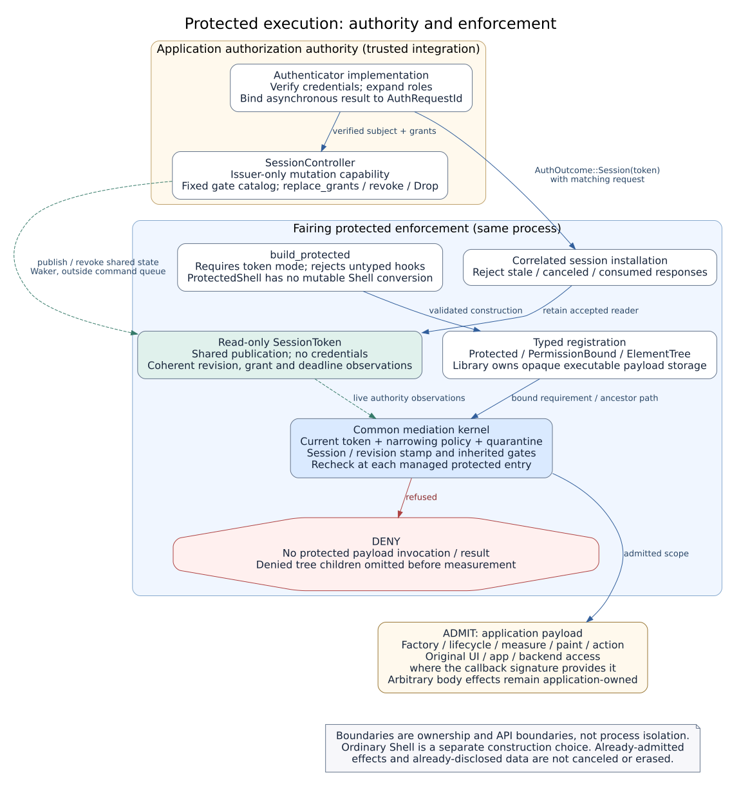
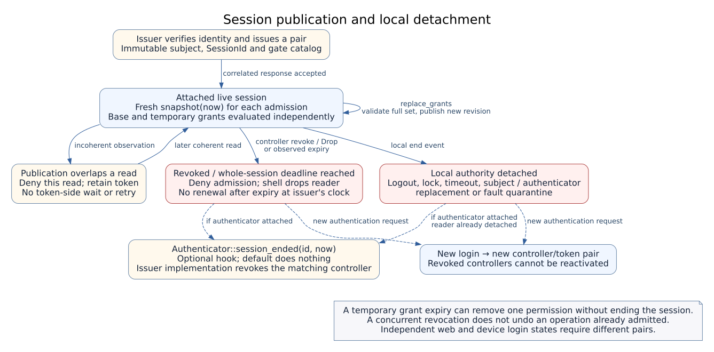

# Security architecture

This document describes the device UI authorization boundary implemented by
Fairing. The [system architecture](architecture.md) covers component ownership,
hosting, update order and device integration. Protocol-level contracts and proof
commands belong to the [session](session-tokens.md) and
[mediation](protected-contracts.md) documents.

## 1. Authority and trust boundaries

The application verifies identity and assigns permissions. Fairing enforces the
current permissions at its managed protected entry points. These responsibilities
are separate even when both implementations run in the same device binary.



Solid arrows show construction, response installation and payload invocation.
Dashed arrows show shared authority observations and wake notifications. These
are API and ownership boundaries within one process, not a sandbox or network
protocol. Fairing supplies no production identity provider or cryptographic
network token. Session IDs are process-local opaque identities.

| Boundary | Responsible owner | Contract |
|---|---|---|
| Credentials, accounts and roles | Application `Authenticator`, optionally `CredentialAdmin` | Verify credentials, classify permissions and enforce account-management rules |
| Mutable authority | Issuer-held `SessionController` | Publish only gates in the issued catalog; keep control of the non-cloneable writer |
| Local accepted session | Fairing access/authentication state | Correlate responses with live `AuthRequestId`; retain only the accepted reader |
| UI declarations and admission | Fairing protected facade, registry and common mediation kernel | Require typed bindings and check live authority before registered protected payload entry |
| Application callback effects | Application callback/backend implementation | Use the received UI/state/backend references according to business policy |
| Physical effects and presentation | Device/backend/host/platform | Enforce device-side authorization, operation cancellation, persistence and actual presentation timing |

Web and device logins that need independent state use different controller/token
pairs. Sharing one pair intentionally shares its authority and revocation; a web
identity must not implicitly become a device UI session.

## 2. Construction and registration

`ShellBuilder::build` constructs an ordinary host with legacy registration and
trusted untyped customization. `build_protected` requires
`access.session_tokens = true`, validates protected-hook restrictions before
backend/authenticator attachment, and returns `ProtectedShell`.

Protected construction rejects untyped global painters/layouts, widget-painter
bundles, image loaders and procedural wallpaper hooks. The facade has private
storage and no mutable conversion to `Shell`. Sealed `HostedShell` lets runners
perform logic, frame, event and fault operations on either mode without changing
that registration boundary. `ProtectedShell::restart_with` requires a protected
replacement; it cannot install an ordinary shell.

Applications define their permission enum or value type with `Permission::gate`.
`Protected::new(value, declaration)` binds a screen, action or UI declaration.
External screens implement `Screen + PermissionBound`; nested UI uses
`ElementTree` and permission-bound elements. Executable bodies are stored in
opaque library-owned carriers generated by `protected_contract!`.

A screen binding controls entry to that screen callback. It does not assign
independent permissions to each arbitrary egui widget inside the body. Register
separate protected actions for independent operations or use permission-bound
elements for separately mediated measurement and painting. Permission metadata
is trusted classification; the [application checker](permission-metadata-check.md)
checks its supported source patterns separately from runtime admission.

## 3. Authentication and session publication

After verifying credentials, the issuer creates a `(SessionController,
SessionToken)` pair and retains the controller. The returned
`AuthOutcome::Session(token)` is installed only for a matching live authentication
request. Asynchronous completion retains the original request identity; stale,
canceled, consumed and unsolicited responses do not install authority.

The pair binds an immutable subject, session identity and gate catalog. Roles are
expanded into explicit independent grants by the issuer. A role name or numeric
level does not imply every permission. Include inactive catalog entries for gates
that may be granted later. `replace_grants` validates the replacement before
publication; unknown gates are rejected and omitted gates lose their rights.

Controller publication and revocation wake the host through shared authority
state; they do not wait behind `ShellHandle`'s bounded command queue. Readers
check a coherent publication revision and current deadlines. An overlapping
publication denies the current read without dropping the reader or retrying
inside the read operation.



The figure separates admission observations and local lifecycle events; it is
not a replacement for the executable session state machine. A temporary grant
can expire while the session and its base grants remain live. A whole-session
deadline denies admission at or after the deadline. Controllers cannot renew an
already expired session at the supplied authoritative clock, and revoked
controllers cannot be reactivated.

Local logout, lock, timeout, subject/authenticator replacement or fault quarantine
first detach the shell's reader and invalidate pending authentication. The shell
then calls `Authenticator::session_ended(session_id, now)`. The issuer must end
only the matching controller; notification about an older session must not revoke
a newer one. Other reader clones remain under the issuer's control. Dropping or
revoking that controller ends all readers of the pair.

## 4. Runtime enforcement and timing

Admission combines the following conditions:

```text
not quarantined AND live token grants the gate AND installed local policy allows it
```

An application policy can narrow token authority; it cannot add issuer grants.
The common kernel also checks inherited permission requirements and the
`(SessionId, revision)` authority stamp. A change during policy evaluation or
between nested operations cannot reuse an earlier successful admission. Missing,
revoked, expired, unlisted or incoherently read authority refuses entry.

`ElementTree` filters denied children before measurement/layout, binds the plan
to its authority state and rechecks live requirements before painting. This
prevents a previously authorized plan from authorizing a new entry after its
binding becomes stale. Registered factories, lifecycle methods, drawing and
actions use the same managed mediation path.

The host's logic/frame contract advances observation time. Authority is checked
during logic-only updates, before queued work, before drawing and at protected
operation boundaries. Hosts calling `logic*` use a monotonic wall timeline;
frame-only hosts use egui input time. Admission uses the shell's monotonic
`Instant`, not the calendar value from `ClockSource::now()`. External token
consumers must take fresh
`snapshot(now)` observations using their authoritative clock rather than cache a
snapshot as a permanent permission.

A successful check is an admission observation, not a lock held over the entire
application operation. Concurrent revocation does not undo a body already
admitted; a frame in progress can finish that admitted rendering pass. Subsequent
observed updates revalidate screens. Already disclosed data, device effects and
scheduler/compositor progress require application/platform contracts.

### Settings and backend operations

`settings::add_all_protected` maps screen IDs to application permission values.
That view permission does not issue setting-write or credential-administration
grants. User writes use `Cx::set_setting` or queued setting dispatch and check the
applicable setting-key grant. Credential administration additionally checks its
individual operation grants and the authenticator's management rules.

Ordinary `Shell::request_service(ServiceRequest::...)` is a trusted host hardware
API, preserving ordinary-host authority without a mutable component loan. It is
not exposed by `ProtectedShell`. An admitted application callback still receives
its documented backend reference; arbitrary direct backend effects inside that
body remain application responsibilities.

## 5. Faults, startup and recovery

Caught runtime unwinds quarantine dispatch and detach local authority. Command
admission closes and old handles remain disconnected across replacement.
Recovery factories and event handlers are trusted host code, so recovery can run
without a live UI session. A protected replacement must be built and validated as
`ProtectedShell`; failed replacement leaves execution quarantined. External
business effects and egui/GPU state are not rolled back by shell replacement.

`ShellConfig::load` deliberately selects defaults for a missing file, including
legacy access defaults. Deployments requiring a provisioned security file must
enforce its presence at the application boundary. Independently,
`build_protected` rejects configuration without token mode. Production credential
storage and verification remain with the integrator; `PinTable` and the public
marker in the development example are reference/demo mechanisms.

## 6. Evidence and implementation map

| Property / diagram relation | Implementation and verification |
|---|---|
| Validated protected construction; no downgrade host API | [`shell/builder.rs`](../crates/fairing/src/shell/builder.rs), [`shell/protected.rs`](../crates/fairing/src/shell/protected.rs), [`shell/host.rs`](../crates/fairing/src/shell/host.rs); external compile-fail clients |
| Issuer-only writer, publication, grant catalog and deadlines | [`access/session.rs`](../crates/fairing/src/access/session.rs), [`access/session_rules.rs`](../crates/fairing/src/access/session_rules.rs); source-bound Kani/Verus decision proofs and session tests |
| Response correlation, session observation and local detach | [`shell/authentication.rs`](../crates/fairing/src/shell/authentication.rs); stale-response, revocation and lifecycle regressions |
| Common admission and inherited authority | [`access/mediation.rs`](../crates/fairing/src/access/mediation.rs), [`access/protected_dispatch.rs`](../crates/fairing/src/access/protected_dispatch.rs); kernel/path proofs |
| Automatic coverage of managed payload entry | [`mediation/contract.rs`](../crates/fairing/src/access/mediation/contract.rs), [`verification/protected_contracts.py`](../verification/protected_contracts.py), [`verification/contract_controls.py`](../verification/contract_controls.py); compiler-derived routing and compiled extension/bypass controls |
| Element-plan and live paint checks | [`elements.rs`](../crates/fairing/src/elements.rs), [`mediation/element.rs`](../crates/fairing/src/access/mediation/element.rs); mediated tree regressions and common route checks |
| User setting and account writes | [`shell/settings_dispatch.rs`](../crates/fairing/src/shell/settings_dispatch.rs), [`access/mod.rs`](../crates/fairing/src/access/mod.rs); denied-write and credential-admin regressions |
| Runtime faults and protected recovery | [`runner.rs`](../crates/fairing/src/runner.rs), [`shell/protected.rs`](../crates/fairing/src/shell/protected.rs); protected-host/replacement regressions |

The proof unit is the shared mediation kernel, combined with compiler-derived
coverage of library-managed protected entries. Kani and Verus check bound
production decisions/path contracts; the routing checker derives carrier,
protocol and operation relationships from compiled Rust and rejects unsupported
reachable contracts. Accepted-extension and rejected-bypass controls exercise
that integration. Test results and source-bound receipts belong to their actual
source/toolchain revisions; this architecture map is not an execution report.

Trusted assumptions include Rust privacy/borrowing, compiler extraction, solver
correctness, authoritative clock observations, permission metadata and the stated
observer interfaces. The result is not a whole-application information-flow,
credential-verifier, arbitrary-callback termination or device-operation
cancellation proof. Detailed guarantees and assumptions are maintained in
[common mediation](protected-contracts.md), [sessions](session-tokens.md),
[metadata checking](permission-metadata-check.md) and
[formal operability](formal-operability.md).
